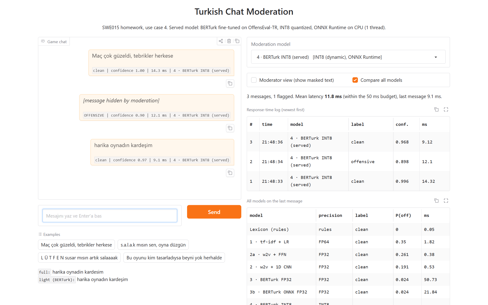
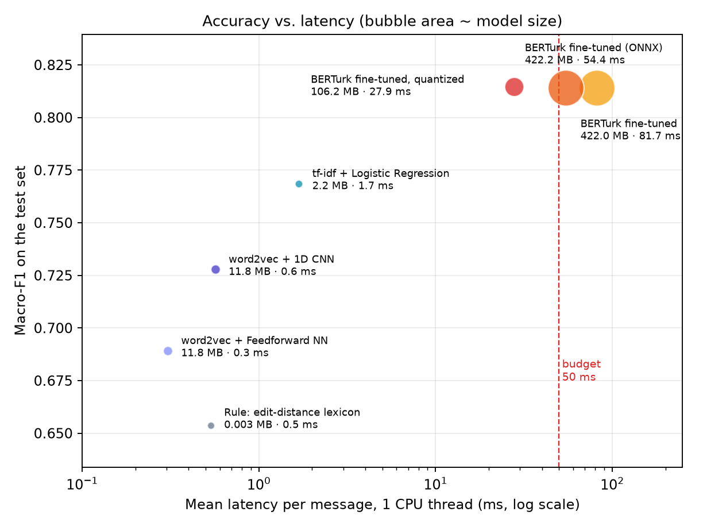
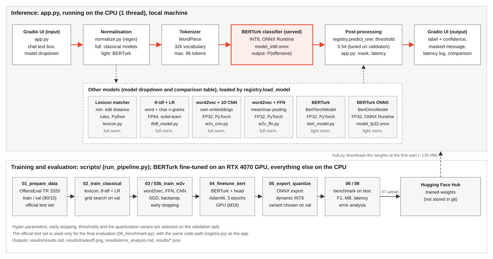

# Real-Time Turkish Chat Moderation

A moderation model for Turkish game chat that runs on one CPU thread. The fine-tuned BERTurk is
quantized to INT8 and classifies a message in **27.9 ms** (mean). It is **4× smaller** and **2.9× faster**
than the original PyTorch model, with the same macro-F1 on the test set.

**SWE015 Introduction to Large Language Models**, homework *Building an Intelligent Application*, Use Case 4

Arda Kocadoru (220901583)

[Slides (PDF)](docs/slides.pdf) · [Model weights on the Hugging Face Hub](https://huggingface.co/ardakocadoru/swe015-chat-moderation) · [Results table](results/results.md) · [Error analysis](results/error_analysis.md)



---

## The problem

On a gaming platform an offensive message has to be hidden before the other players see it. The model checks every
message before it is shown, so its run time adds to the delay of every message. The chat servers have no GPU.
That gives two hard requirements:

* **Latency budget:** at most **50 ms** mean per message on **1 CPU thread**, batch size 1.
* **Quality:** the highest macro-F1 on the official OffensEval-TR 2020 test set (3,528 tweets, 20% offensive).

## Results

All models are scored on the same held-out test set. Latency is end-to-end (normalisation + tokenisation + model),
mean of 300 runs on an AMD Ryzen 7 5700X.

| Ladder step | Model | Macro-F1 | Size | Mean latency, 1 thread | Within 50 ms |
|---|---|---:|---:|---:|:---:|
| Rule baseline | Edit-distance lexicon | 0.654 | 0.003 MB | 0.53 ms | yes |
| 1 · Classical | tf-idf + logistic regression | 0.769 | 2.2 MB | 1.68 ms | yes |
| 2a · Neural network | Own word2vec + feedforward network | 0.689 | 11.8 MB | 0.30 ms | yes |
| 2 · Neural network | Own word2vec + 1D CNN | 0.728 | 11.8 MB | 0.57 ms | yes |
| 3 · Transformer | BERTurk fine-tuned, PyTorch FP32 | 0.814 | 422.0 MB | 81.65 ms | no |
| 3b · Transformer | Same model, ONNX Runtime FP32 | 0.814 | 422.2 MB | 54.35 ms | no |
| **4 · Quantized** | **Same model, ONNX Runtime INT8 (served)** | **0.815** | **106.2 MB** | **27.85 ms** | **yes** |



### What the numbers show

1. **Only the quantized BERTurk is both the most accurate model and within the budget.** BERTurk is 0.046 macro-F1
   above tf-idf, the best model without pre-training. In FP32 it needs 81.65 ms per message.
2. **ONNX export alone is not enough.** It cuts latency from 81.65 to 54.35 ms with identical outputs
   (largest probability difference 9 × 10⁻⁶), but 54 ms is still over the budget. Dynamic INT8 quantization brings it
   to 27.85 ms (median 22.83 ms) and from 422 MB to 106 MB.
3. **Quantization cost no accuracy.** Test macro-F1 went from 0.814 to 0.815. INT8 and FP32 disagree on 47 of the
   3,528 test tweets (1.3%).
4. **The quantization scheme matters a lot.** Four INT8 variants were compared on the validation split.
   Per-channel weight quantization broke the model: validation macro-F1 fell from 0.836 to 0.447. Per-tensor
   quantization kept 0.828, and also quantizing the embedding matrix took the file from 178 MB to 106 MB for another
   0.001 F1. The variant was chosen on validation data only ([`quantization_check.json`](results/quantization_check.json)).
5. **Word2vec trained on 28,580 tweets does not beat tf-idf.** The 1D CNN improves on the feedforward network
   (0.728 vs 0.689) but stays below tf-idf (0.769). For a dataset this small, character n-grams handle Turkish
   suffixes and misspellings better than word vectors learned from scratch. Pre-training is what closes the gap.

The served model finds 471 of the 716 offensive test tweets (recall 66%). When it flags a message, it is right 75% of
the time (159 false positives, 245 false negatives). Examples of both error types are in
[`results/error_analysis.md`](results/error_analysis.md).

## Architecture



Each message goes through these steps:

1. **Normalisation** (`moderation/normalize.py`). Regular expressions undo common tricks used to dodge filters.
   Both versions remove mentions and URLs and fix repeated letters (`salaaaak`) and spaced-out letters
   (`s.a.l.a.k`, `L Ü T F E N`). The full version for the classical models also decodes leetspeak (`s4l4k`),
   lower-cases with Turkish rules (`I → ı`, `İ → i`) and folds Turkish letters to ASCII. BERTurk gets the light
   version, which keeps the Turkish letters because BERTurk is a cased model with its own tokenizer.
2. **Tokenisation.** BERTurk's 32k WordPiece vocabulary, at most 96 tokens (the 95th percentile tweet is 36 words).
3. **Classification.** INT8 BERTurk on ONNX Runtime returns P(offensive).
4. **Decision.** Threshold 0.54, tuned on the validation split. Offensive messages are masked and the latency is logged.

The other six models load through the same registry (`moderation/registry.py`), which the app and the benchmark
share, so both run exactly the same normalisation and model code.

---

## Quick start

Requirements: **Python 3.12** (tested; 3.13 and 3.14 also work for the app), about 1 GB of free disk,
internet access on the first start.

```bash
git clone https://github.com/ardakocadoru/swe015-chat-moderation.git
cd swe015-chat-moderation
python -m venv .venv            # Windows with several Pythons: py -3.12 -m venv .venv
# Windows: .venv\Scripts\activate     macOS/Linux: source .venv/bin/activate
pip install -r requirements.txt
python app.py
```

`python app.py` is the single run command. On the first start it downloads the trained weights
(~135 MB) from the Hugging Face Hub ([`ardakocadoru/swe015-chat-moderation`](https://huggingface.co/ardakocadoru/swe015-chat-moderation)) and opens the app at
<http://127.0.0.1:7860>. To also download the two FP32 BERTurk variants (~850 MB) for the side-by-side
comparison, start it once with `ALL_MODELS=1 python app.py` (PowerShell: `$env:ALL_MODELS="1"; python app.py`).

### Using the app

* Type a Turkish chat message and press **Enter**. It is labelled **clean / offensive** with a confidence score.
  Offensive messages are hidden; tick *Moderator view* to see them struck through.
* **Moderation model:** switch to any model of the ladder (default: INT8 BERTurk).
* **Response-time log:** end-to-end latency of every message, measured with 1 CPU thread, the same setting as the
  latency budget.
* **All models on the last message:** the predictions and latencies of every model side by side.
* The *Normalised input* line shows what the normaliser made of the message.

---

## Reproduce everything

```bash
python scripts/run_pipeline.py      # runs steps 01-06 and 08 below in order
```

| Script | What it does | Output |
|---|---|---|
| `01_prepare_data.py` | Downloads OffensEval-TR 2020, stratified 90/10 train/validation split of the official training set (seed 42); the official test set is the held-out test set | `data/processed/*.csv`, `results/data_stats.json` |
| `02_train_classical.py` | Builds the lexicon from the training data, tunes it and tf-idf + LR on validation | `models/lexicon`, `models/tfidf` |
| `03_train_w2v_ffn.py` | Trains word2vec, then the feedforward network with SGD (early stopping on validation) | `models/w2v_ffn` |
| `03b_train_w2v_cnn.py` | 1D CNN initialised with the word2vec vectors, SGD, early stopping on validation | `models/w2v_cnn` |
| `04_finetune_bert.py` | Fine-tunes BERTurk (3 epochs, AdamW, bf16 on GPU, 4.5 min on an RTX 4070) | `models/berturk_fp32` |
| `05_export_quantize.py` | ONNX export, compares INT8 dynamic-quantization variants on validation, keeps the smallest one within 0.01 macro-F1 of FP32 | `models/berturk_onnx` |
| `06_benchmark.py` | Scores all models on the test set; size on disk; latency (batch 1, 300 runs on a freshly loaded model after 20 warm-up calls on other messages, 1 and 4 threads) | `results/results.{json,md}`, `results/tradeoff.png`, `results/test_predictions.csv` |
| `07_upload_to_hub.py` | Uploads `models/` to the Hugging Face Hub (not part of `run_pipeline.py`) | Hugging Face model repo |
| `08_error_analysis.py` | False positives and negatives, model disagreements, quantization flips | `results/error_analysis.md` |
| `09_build_slides.py` | Builds the figures and the presentation from `results/` (needs Edge or Chrome for the PDF) | `docs/slides.pdf` |

Fine-tuning BERTurk needs a CUDA GPU for reasonable speed. For CUDA, install PyTorch from the
PyTorch index first, e.g. `pip install torch==2.15.0 --index-url https://download.pytorch.org/whl/cu132`.
Everything else runs on a CPU.

### Evaluation protocol

* Hyper-parameters, early stopping, decision thresholds and the quantization variant are chosen on the
  **validation split only**. The test split is used once, in `06_benchmark.py`, and is the same for every model.
* Latency: batch size 1, a freshly loaded model, 20 warm-up calls, then 300 timed runs on different test messages.
  Mean, median and p95 are reported for 1 and 4 threads.
* Hardware: AMD Ryzen 7 5700X (8 cores), 32 GB RAM, Windows 11, CPU only. PyTorch 2.15.0, ONNX Runtime 1.32.0.
  Full details in [`results/results.md`](results/results.md).
* Every number in this README and in the slides comes from `results/*.json`. The slides are generated from
  those files by `09_build_slides.py`, so the slides and the measurements cannot disagree.

## Limitations

* **Tweets, not game chat.** The model is trained on Turkish tweets. Game chat has its own slang, and the scores
  above should be checked on labelled chat logs before deployment.
* **Veiled insults get through.** Indirect insults with no offensive word, such as *"Senin için yansın ama seni
  yaksın"*, are often missed. Some of the 245 false negatives also look like labelling errors in the dataset.
* **Tail latency.** The mean is well inside the budget, but the p95 on one thread is 58.5 ms. With 4 threads the
  p95 is 32.1 ms.

---

## Repository layout

```
app.py                     Gradio application (the single run command)
moderation/
  config.py                paths and constants
  data.py                  download + fixed splits
  normalize.py             regex normalisation (leetspeak, repeated letters, Turkish casing, ...)
  lexicon.py               minimum edit distance + lexicon matcher (rule baseline)
  tfidf_model.py           tf-idf + logistic regression
  w2v_ffn.py               word2vec + feedforward network
  w2v_cnn.py               1D CNN over the word2vec embeddings
  bert_model.py            BERTurk inference with PyTorch (FP32) and ONNX Runtime (FP32 / INT8)
  registry.py              loads any model of the ladder (shared by app and benchmark)
  metrics.py               macro-F1 etc., threshold tuning on validation
  hub.py                   downloads weights from the Hugging Face Hub
scripts/                   01-09 pipeline steps (see above)
results/                   all measured numbers and figures
docs/                      architecture diagram, slides
```

Model weights are not stored in this repository. They are on the Hugging Face Hub and the app downloads them.

## Data and credits

* **OffensEval-TR 2020**: Çağrı Çöltekin. *A Corpus of Turkish Offensive Language on Social Media.*
  LREC 2020, pp. 6174–6184. 31,756 training + 3,528 test tweets, labels NOT / OFF. Licence CC-BY 2.0.
  <https://coltekin.github.io/offensive-turkish/>
* **BERTurk**: Stefan Schweter, `dbmdz/bert-base-turkish-cased`, MIT licence.
  <https://huggingface.co/dbmdz/bert-base-turkish-cased>

Methods follow: T. Mikolov et al., *Distributed Representations of Words and Phrases*, NeurIPS 2013 (word2vec);
Y. Kim, *Convolutional Neural Networks for Sentence Classification*, EMNLP 2014 (1D CNN);
L. Tunstall, L. von Werra, T. Wolf, *Natural Language Processing with Transformers*, ch. 8 (quantization, ONNX).

The dataset contains offensive language. The tweets are downloaded by `scripts/01_prepare_data.py` and are not
stored in this repository: `results/test_predictions.csv` holds tweet ids and model scores only. The error analysis
and the slides quote a few test tweets (CC-BY 2.0, attribution above); tweets with strong profanity, sexual,
political or religious content are left out of these examples. The rule baseline never adds names of people,
parties or organisations, or words for ethnic, religious or national groups, to its word list
(`moderation/lexicon.py`): they name a topic, not an insult.
